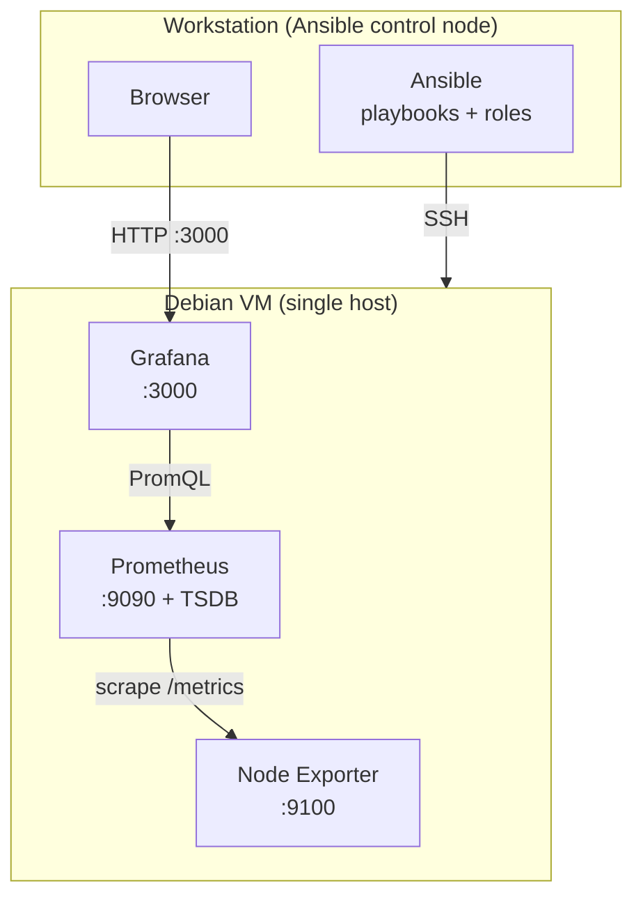

# deb-observability-lab

> Reproducible Linux monitoring lab built entirely with Ansible on Debian.

`deb-observability-lab` deploys and configures a complete observability stack —
Prometheus, Node Exporter and Grafana — using Infrastructure as Code.
It is designed to run on a single local Debian VM for development and testing, and
to scale to a multi-host setup by editing the Ansible inventory, without a redesign.

> Project status: work in progress. This repository is being built incrementally,
> milestone by milestone (see [Roadmap](#roadmap)). Features are only considered done
> when their acceptance criteria are met. Nothing here assumes a deployment that has
> not actually been run.

## What it demonstrates

- Reproducible, idempotent deployments with Ansible (roles, handlers, Ansible Vault).
- System metrics collection: CPU, memory, filesystem, host availability.
- Dashboards provisioned as code in Grafana (no manual clicking).
- Incident detection (stopped service / unreachable host) and documented recovery.
- Automated validation (`yamllint`, `ansible-lint`, syntax & dry-run checks) in CI,
  with no paid infrastructure.

## Scope

Local-first. No public cloud, no paid services, no containers (Docker / Kubernetes),
no Terraform. The focus is Linux system administration and Ansible fundamentals applied
to a realistic observability use case.

Optional later phases: Alertmanager notifications, multi-VM separation, Molecule tests,
TLS / authenticated reverse proxy.

## Architecture

The minimum viable architecture runs every component on a single Debian VM. The
Ansible control node is your workstation.



Data flow (pull model): Prometheus scrapes Node Exporter over HTTP, stores the series in
its local TSDB, and Grafana queries Prometheus to render dashboards. Moving to a
multi-host layout (dedicated monitoring host + several monitored hosts) only requires
moving hosts between inventory groups.

See [`docs/architecture.md`](docs/architecture.md) for the detailed design and the
future multi-host diagram.

### Components and ports

| Component | Runs on | Port | Role |
|---|---|---|---|
| Node Exporter | every monitored host | `9100` | Exposes Linux host metrics at `/metrics` |
| Prometheus | monitoring host | `9090` | Scrapes exporters, stores metrics, evaluates alert rules |
| Grafana | monitoring host | `3000` | Dashboards and visualization |
| Alertmanager *(optional, later)* | monitoring host | `9093` | Alert routing and notifications |

In the MVP all of these run on the same VM. Ports are bound to the private VM network
only; nothing is exposed to an untrusted network.

## Repository layout

```
deb-observability-lab/
├── ansible.cfg                  # Ansible defaults (inventory, roles_path, SSH)
├── Makefile                     # Standard local validation commands
├── requirements-dev.txt         # Ansible and linting tools
├── inventory/
│   ├── hosts.ini                # local fallback inventory (localhost)
│   ├── hosts.example.ini        # example Debian VM inventory
│   └── group_vars/all.yml       # shared variables (e.g. Node Exporter port)
├── playbooks/
│   ├── site.yml                 # connectivity check; future full orchestration
│   ├── deploy-node-exporter.yml # Node Exporter deployment
│   ├── deploy-prometheus.yml   # Prometheus deployment
│   ├── deploy-grafana.yml      # Grafana deployment
│   └── deploy-alertmanager.yml # Alertmanager deployment
├── roles/
│   ├── node_exporter/           # Debian package, config template and handler
│   ├── prometheus/              # Debian package, inventory-driven scrape config
│   ├── grafana/                 # Grafana APT repo, datasource and dashboards as code
│   └── alertmanager/            # Debian package, alert routing configuration
├── files/                       # static files added in later milestones
├── tests/
│   └── smoke/                   # metrics and health endpoint smoke tests
├── docs/
│   ├── local-development.md     # local workstation and VM guidance
│   └── runbook.md               # operations, incident simulation and recovery
└── .github/workflows/ci.yml     # yamllint + ansible-lint + syntax & dry-run checks
```

## Prerequisites

Control node (your workstation):
- Python 3.11+
- Ansible (installed from `requirements-dev.txt`)
- `ansible-lint`, `yamllint`
- An SSH key pair for a future VM target

Target (recommended): a local Debian 13 (Trixie) VM.
KVM/libvirt is the preferred local virtualization option when available. The repository
also includes a `localhost` fallback so the first Ansible connectivity check does not
require a VM. VM provisioning is intentionally not a runtime dependency of the roles;
its exact setup will be added once the local hypervisor workflow is defined.

See [`docs/local-development.md`](docs/local-development.md) for both workflows.

## Quick start

> Milestone 0 workflow. The monitoring stack is added incrementally.

```bash
# 1. Create an isolated local Python environment
python3 -m venv .venv
. .venv/bin/activate

# 2. Install Ansible and validation tools
python -m pip install -r requirements-dev.txt

# 3. Validate the repository
make lint
make syntax
make check

# 4. Run the connectivity playbook against localhost
make ping
```

The versioned local inventory only runs the connectivity check. A Debian VM can be targeted
with a local inventory based on `inventory/hosts.example.ini`.

## Milestone 1: Node Exporter

Run the deployment against the VM inventory, not against the localhost fallback:

```bash
ansible-playbook \\
  -i inventory/hosts.local.ini \\
  playbooks/deploy-node-exporter.yml \\
  --private-key ~/.ssh/deb-observability-lab \\
  --ask-become-pass
```

Validate the metrics endpoint from the control node:

```bash
bash tests/smoke/node_exporter.sh 192.168.122.60
```

Run the playbook a second time. Once the role is stable, the second run should report
`changed=0`.

## Milestone 2: Prometheus

Deploy Prometheus on the monitoring host. Its scrape configuration is generated from the
`monitored` inventory group, so new hosts are picked up without editing templates:

```bash
ansible-playbook \\
  -i inventory/hosts.local.ini \\
  playbooks/deploy-prometheus.yml \\
  --private-key ~/.ssh/deb-observability-lab \\
  --ask-become-pass
```

Validate Prometheus health and the query API from the control node:

```bash
bash tests/smoke/prometheus.sh 192.168.122.60
```

The rendered configuration is validated with `promtool check config` before it is applied,
and the service is reloaded (not restarted) when the scrape configuration changes.

## Milestone 3: Grafana

Grafana is not available in the official Debian repositories, so the role adds Grafana's
own signed APT repository (key stored in a dedicated keyring, `signed-by` enforced) and
then installs the `grafana` package. The Prometheus datasource and the dashboards are
provisioned as code, so nothing is created by clicking in the UI:

```bash
ansible-playbook \\
  -i inventory/hosts.local.ini \\
  playbooks/deploy-grafana.yml \\
  --private-key ~/.ssh/deb-observability-lab \\
  --ask-become-pass
```

The admin credentials are not hardcoded in the role: the default is a lab placeholder
that should be overridden at deploy time (for example with `-e @secrets.local.yml` or
Ansible Vault). Grafana only applies the admin password when it first initialises its
database.

Validate the Grafana health endpoint from the control node:

```bash
bash tests/smoke/grafana.sh 192.168.122.60
```

Then open `http://192.168.122.60:3000`, log in, and confirm the provisioned
Prometheus datasource and the "Node overview" dashboard show live data.

## Milestone 4: Incident detection

The `prometheus` role deploys alert rules to `/etc/prometheus/rules/alerts.yml`
(`InstanceDown`, plus CPU / memory / disk thresholds). Rules are validated with
`promtool check rules` before they are applied, and Prometheus is reloaded on change.
Alerts fire inside Prometheus and appear on `/alerts`; routing and notifications are
deferred to the optional Alertmanager milestone.

Re-run the Prometheus deployment to ship the rules:

```bash
ansible-playbook \\
  -i inventory/hosts.local.ini \\
  playbooks/deploy-prometheus.yml \\
  --private-key ~/.ssh/deb-observability-lab \\
  --ask-become-pass
```

Confirm the rules are loaded:

```bash
bash tests/smoke/alert_rules.sh 192.168.122.60
```

Simulate a failure and watch it being detected, then recover, following the documented
procedure in [`docs/runbook.md`](docs/runbook.md). In short: stopping
`prometheus-node-exporter` on the VM drives `up` to `0` and makes `InstanceDown` fire
after one minute; starting it again clears the alert.

## Milestone 5: Alertmanager

The `alertmanager` role installs the Debian `prometheus-alertmanager` package and
configures alert routing (grouping, deduplication, repeat interval). Prometheus is wired
to it through an `alerting:` block, enabled lab-wide by `prometheus_alertmanager_enabled`
in `inventory/group_vars/all.yml`. The rendered configuration is validated with
`amtool check-config` before it is applied.

The default receiver performs no external notification: alerts are grouped and visible in
the Alertmanager UI, which validates the routing pipeline without any cloud or paid
service. Wiring a real receiver (email, webhook, chat) with its secrets stored in Ansible
Vault is a documented later hardening step.

Deploy Alertmanager, then re-run Prometheus so it learns about it:

```bash
ansible-playbook \\
  -i inventory/hosts.local.ini \\
  playbooks/deploy-alertmanager.yml \\
  --private-key ~/.ssh/deb-observability-lab \\
  --ask-become-pass

ansible-playbook \\
  -i inventory/hosts.local.ini \\
  playbooks/deploy-prometheus.yml \\
  --private-key ~/.ssh/deb-observability-lab \\
  --ask-become-pass
```

Confirm Alertmanager health and that Prometheus registered it:

```bash
bash tests/smoke/alertmanager.sh 192.168.122.60
```

Run the incident simulation from [`docs/runbook.md`](docs/runbook.md) again: the firing
`InstanceDown` alert now also appears in the Alertmanager UI at
`http://192.168.122.60:9093`, grouped by `alertname` and `instance`.

## Testing & acceptance criteria

Milestone 0 acceptance criteria:
- The development dependencies install in an isolated Python environment.
- `yamllint` passes.
- `ansible-lint` passes.
- `ansible-playbook --syntax-check playbooks/site.yml` passes.
- `ansible-playbook --check --diff playbooks/site.yml` passes.
- The connectivity playbook reaches the local target with `ping: pong`.
- The same checks run automatically in GitHub Actions without a VM.

Milestone 1 acceptance criteria:
- The Node Exporter role installs successfully on the Debian VM.
- The `prometheus-node-exporter` service is enabled and active.
- `http://<vm>:9100/metrics` returns Linux host metrics.
- A second Ansible run reports `changed=0`.
- Changing the managed configuration triggers the Node Exporter handler.

Milestone 2 acceptance criteria:
- The Prometheus role installs successfully on the monitoring host.
- The `prometheus` service is enabled and active.
- The rendered `prometheus.yml` passes `promtool check config`.
- `http://<vm>:9090/-/healthy` reports Prometheus as healthy.
- Every `monitored` host appears as a scrape target with `up == 1`.
- A second Ansible run reports `changed=0`.
- Changing the scrape configuration triggers a Prometheus reload.

Milestone 3 acceptance criteria:
- The Grafana role installs successfully on the monitoring host.
- The `grafana-server` service is enabled and active.
- `http://<vm>:3000/api/health` reports `"database": "ok"`.
- The Prometheus datasource is provisioned and healthy.
- The "Node overview" dashboard is provisioned and shows live data.
- A second Ansible run reports `changed=0`.

Milestone 4 acceptance criteria:
- The `prometheus` role deploys `/etc/prometheus/rules/alerts.yml`.
- The rendered rules pass `promtool check rules`.
- `http://<vm>:9090/api/v1/rules` lists the `InstanceDown` rule.
- Stopping Node Exporter drives `up{job="node"}` to `0`.
- `InstanceDown` transitions to `firing` after its `for` window.
- Starting the service again clears the alert and `up` returns to `1`.
- A second Ansible run reports `changed=0`.

Milestone 5 acceptance criteria:
- The `alertmanager` role installs successfully on the monitoring host.
- The `prometheus-alertmanager` service is enabled and active.
- The rendered `alertmanager.yml` passes `amtool check-config`.
- `http://<vm>:9093/-/healthy` reports Alertmanager as healthy.
- `http://<vm>:9090/api/v1/alertmanagers` lists the Alertmanager as active.
- A firing `InstanceDown` alert is visible in the Alertmanager UI.
- A second Ansible run reports `changed=0`.

## Security

Sensible defaults for a local lab:

- Monitoring interfaces bound to the private VM network only — not exposed publicly.
- Least privilege: dedicated, shell-less system users for `node_exporter` and `prometheus`;
  hardened systemd units.
- No hardcoded secrets. The Grafana admin password and any sensitive values are stored
  with Ansible Vault; password files and local secrets are git-ignored.
- Clear separation between configuration (managed in `/etc`) and runtime data
  (persisted under `/var/lib`, never committed).

Before exposing the stack to an untrusted network you would additionally need TLS
everywhere, an authenticated reverse proxy in front of Grafana/Prometheus, and
authentication on the metrics endpoints. These are explicitly out of scope for the
local lab and documented as future hardening.

## Roadmap

| Milestone | Objective |
|---|---|
| 0 | Local Ansible environment + connectivity + CI lint |
| 1 | `node_exporter` role (first full idempotent IaC chain) |
| 2 | `prometheus` role (scrape + store, config generated from inventory) |
| 3 | `grafana` role (datasource + dashboards provisioned as code) |
| 4 | Incident detection (alert rules) + runbook + smoke tests |
| 5 | Alertmanager + alert routing (external notifications via Vault, optional) |
| 6 *(optional)* | Multi-VM separation |
| 7 *(optional)* | Molecule tests + TLS/auth hardening |
