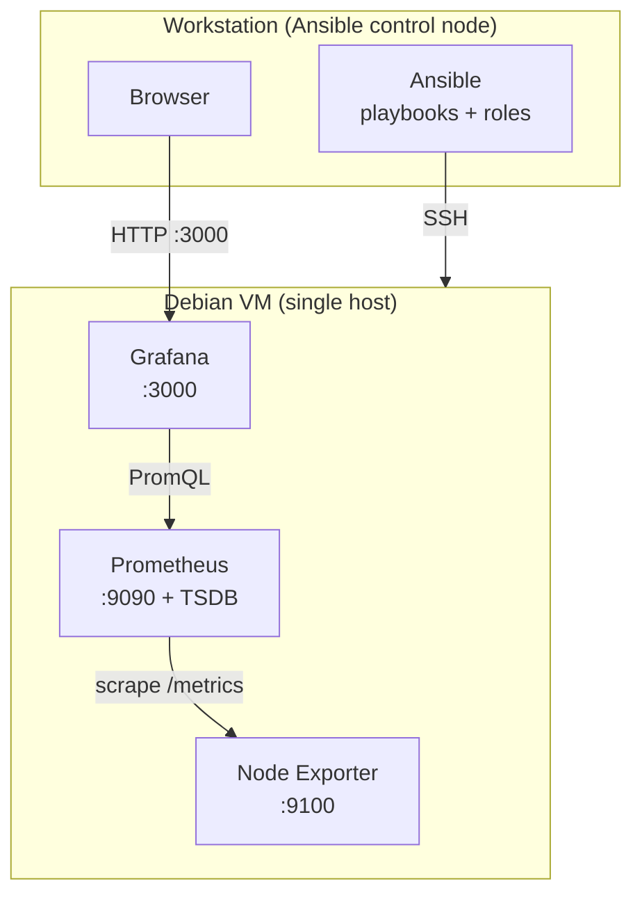

# deb-observability-lab

> Reproducible Linux monitoring lab built entirely with Ansible on Debian.

`deb-observability-lab` deploys and configures a complete observability stack —
Prometheus, Node Exporter and Grafana — using Infrastructure as Code.
It is designed to run on a single local Debian VM for development and testing, and
to scale to a multi-host setup by editing the Ansible inventory, without a redesign.

> Project status: work in progress. This repository is being built incrementally,
> milestone by milestone (see [Roadmap](#roadmap)). Features are only considered done
> when their acceptance criteria are met. Nothing here assumes a deployment that has
> not actually been run.

## What it demonstrates

- Reproducible, idempotent deployments with Ansible (roles, handlers, Ansible Vault).
- System metrics collection: CPU, memory, filesystem, host availability.
- Dashboards provisioned as code in Grafana (no manual clicking).
- Incident detection (stopped service / unreachable host) and documented recovery.
- Automated validation (`yamllint`, `ansible-lint`, syntax & dry-run checks) in CI,
  with no paid infrastructure.

## Scope

Local-first. No public cloud, no paid services, no containers (Docker / Kubernetes),
no Terraform. The focus is Linux system administration and Ansible fundamentals applied
to a realistic observability use case.

Optional later phases: Alertmanager notifications, multi-VM separation, Molecule tests,
TLS / authenticated reverse proxy.

## Architecture

The minimum viable architecture runs every component on a single Debian VM. The
Ansible control node is your workstation.



Data flow (pull model): Prometheus scrapes Node Exporter over HTTP, stores the series in
its local TSDB, and Grafana queries Prometheus to render dashboards. Moving to a
multi-host layout (dedicated monitoring host + several monitored hosts) only requires
moving hosts between inventory groups.

See [`docs/architecture.md`](docs/architecture.md) for the detailed design and the
future multi-host diagram.

### Components and ports

| Component | Runs on | Port | Role |
|---|---|---|---|
| Node Exporter | every monitored host | `9100` | Exposes Linux host metrics at `/metrics` |
| Prometheus | monitoring host | `9090` | Scrapes exporters, stores metrics, evaluates alert rules |
| Grafana | monitoring host | `3000` | Dashboards and visualization |
| Alertmanager *(optional, later)* | monitoring host | `9093` | Alert routing and notifications |

In the MVP all of these run on the same VM. Ports are bound to the private VM network
only; nothing is exposed to an untrusted network.

## Repository layout

```
deb-observability-lab/
├── ansible.cfg                  # Ansible defaults (inventory, roles_path, SSH)
├── Makefile                     # Standard local validation commands
├── requirements-dev.txt         # Ansible and linting tools
├── inventory/
│   ├── hosts.ini                # local fallback inventory (localhost)
│   └── hosts.example.ini        # example Debian VM inventory
├── playbooks/
│   └── site.yml                 # current connectivity check; future orchestration
├── roles/                       # reusable roles added in later milestones
├── files/                       # static files added in later milestones
├── tests/                       # smoke and integration tests added later
├── docs/
│   └── local-development.md     # local workstation and VM guidance
└── .github/workflows/ci.yml     # yamllint + ansible-lint + syntax & dry-run checks
```

## Prerequisites

Control node (your workstation):
- Python 3.11+
- Ansible (installed from `requirements-dev.txt`)
- `ansible-lint`, `yamllint`
- An SSH key pair for a future VM target

Target (recommended): a local Debian 13 (Trixie) VM.
KVM/libvirt is the preferred local virtualization option when available. The repository
also includes a `localhost` fallback so the first Ansible connectivity check does not
require a VM. VM provisioning is intentionally not a runtime dependency of the roles;
its exact setup will be added once the local hypervisor workflow is defined.

See [`docs/local-development.md`](docs/local-development.md) for both workflows.

## Quick start

> Current Milestone 0 workflow. The monitoring stack will be added in later milestones.

```bash
# 1. Create an isolated local Python environment
python3 -m venv .venv
. .venv/bin/activate

# 2. Install Ansible and validation tools
python -m pip install -r requirements-dev.txt

# 3. Validate the repository
make lint
make syntax
make check

# 4. Run the connectivity playbook against localhost
make ping
```

The versioned local inventory only runs the connectivity check. A future Debian VM can
be targeted by creating a local inventory from `inventory/hosts.example.ini`.

## Testing & acceptance criteria

Milestone 0 acceptance criteria:
- The development dependencies install in an isolated Python environment.
- `yamllint` passes.
- `ansible-lint` passes.
- `ansible-playbook --syntax-check playbooks/site.yml` passes.
- `ansible-playbook --check --diff playbooks/site.yml` passes.
- The connectivity playbook reaches the local target with `ping: pong`.
- The same checks run automatically in GitHub Actions without a VM.

Future local VM acceptance criteria:
- Clean deployment from a fresh Debian succeeds.
- A second run reports `changed=0` (idempotence).
- `curl http://<vm>:9100/metrics` returns metrics.
- Prometheus shows the target as `up == 1`.
- Grafana datasource is healthy and the dashboard shows live data.
- Failure simulation makes the target `up == 0`, followed by successful recovery.

The VM-dependent criteria belong to later milestones.

## Security

Sensible defaults for a local lab:

- Monitoring interfaces bound to the private VM network only — not exposed publicly.
- Least privilege: dedicated, shell-less system users for `node_exporter` and `prometheus`;
  hardened systemd units.
- No hardcoded secrets. The Grafana admin password and any sensitive values are stored
  with Ansible Vault; password files and local secrets are git-ignored.
- Clear separation between configuration (managed in `/etc`) and runtime data
  (persisted under `/var/lib`, never committed).

Before exposing the stack to an untrusted network you would additionally need TLS
everywhere, an authenticated reverse proxy in front of Grafana/Prometheus, and
authentication on the metrics endpoints. These are explicitly out of scope for the
local lab and documented as future hardening.

## Roadmap

| Milestone | Objective |
|---|---|
| 0 | Local Ansible environment + connectivity + CI lint |
| 1 | `node_exporter` role (first full idempotent IaC chain) |
| 2 | `prometheus` role (scrape + store, config generated from inventory) |
| 3 | `grafana` role (datasource + dashboards provisioned as code) |
| 4 | Incident detection (alert rules) + runbook + smoke tests |
| 5 *(optional)* | Alertmanager + notifications |
| 6 *(optional)* | Multi-VM separation |
| 7 *(optional)* | Molecule tests + TLS/auth hardening |
