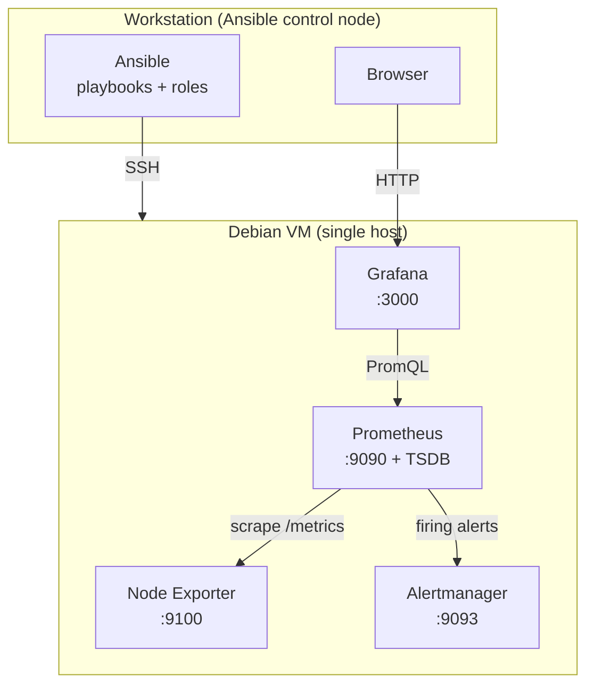
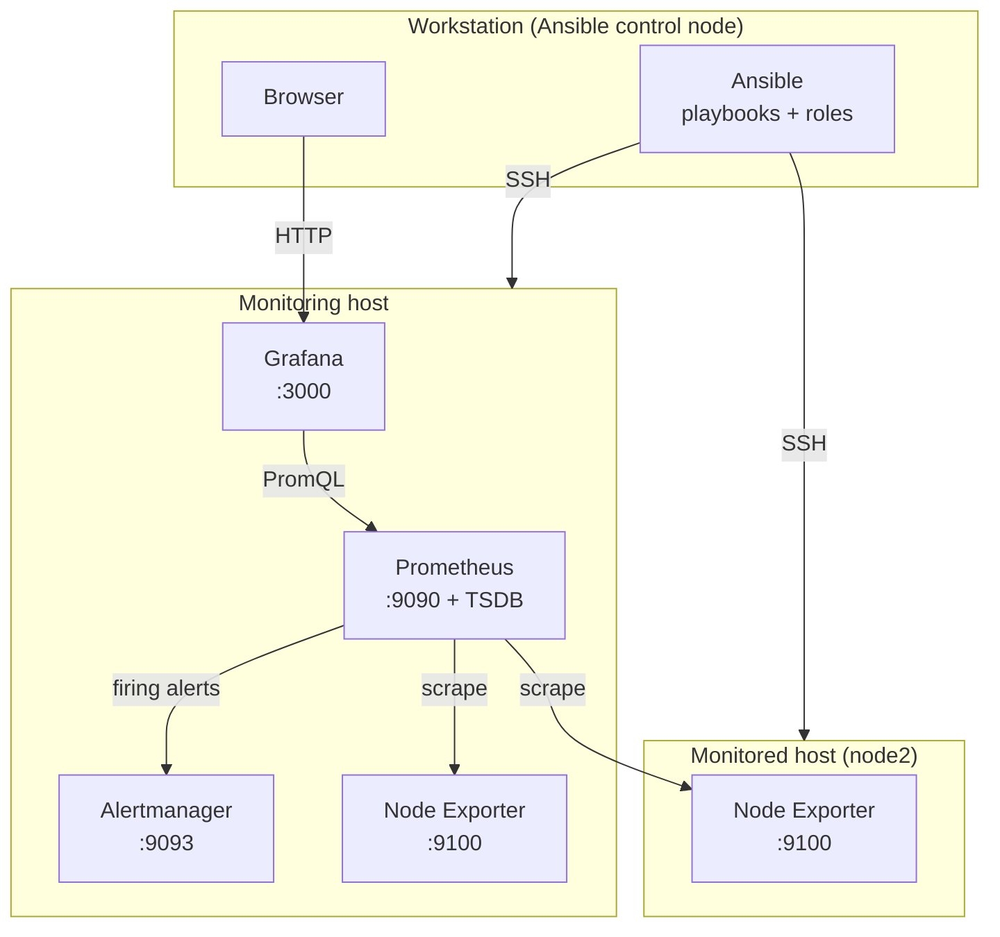

# Architecture

This document describes the design of the monitoring lab, the data flow between its
components, and how it scales from a single VM to a multi-host layout without a redesign.

## Design principles

- Pull-based metrics: Prometheus scrapes exporters, rather than agents pushing data.
- Inventory-driven configuration: the scrape targets are generated from the `monitored`
  Ansible group, so topology changes live in the inventory, not in role templates.
- Role boundaries follow host roles: a host is `monitoring`, `monitored`, or both. The
  same roles apply unchanged whether those roles share a VM or sit on separate VMs.
- Local-first: everything runs on local Debian VMs managed with KVM/libvirt. No public
  cloud, no containers, no paid services.

## Components and responsibilities

| Component | Host role | Port | Responsibility |
|---|---|---|---|
| Node Exporter | monitored | `9100` | Exposes Linux host metrics (CPU, memory, filesystem, load, uptime) at `/metrics` |
| Prometheus | monitoring | `9090` | Scrapes exporters, stores series in its local TSDB, evaluates alert rules |
| Grafana | monitoring | `3000` | Queries Prometheus and renders dashboards provisioned as code |
| Alertmanager | monitoring | `9093` | Receives firing alerts from Prometheus; groups, deduplicates and routes them |
| nginx reverse proxy | monitoring | `443` | Terminates TLS and enforces HTTP basic auth in front of a web UI |

The Ansible control node is your workstation; it connects to every VM over SSH and is not
part of the running stack.

## Data flow

The flow is a pull pipeline:

1. Node Exporter runs on each monitored host and publishes metrics at `/metrics`.
2. Prometheus scrapes every target in the `monitored` group on `:9100` at a fixed
   interval and writes the samples to its TSDB under `/var/lib/prometheus`.
3. Prometheus continuously evaluates the alert rules; a firing alert is pushed to
   Alertmanager on `:9093`.
4. Grafana queries Prometheus with PromQL on `:9090` to render dashboards.
5. The operator reaches Grafana (`:3000`), Prometheus (`:9090`) and Alertmanager
   (`:9093`) over the private VM network from a browser.

## Minimum viable architecture (single VM)

Every component runs on one Debian VM. The host belongs to both the `monitoring` and the
`monitored` groups, so it monitors itself. This is the MVP and the default lab topology.

## Multi-host architecture

Scaling out is an inventory change, not a redesign. The monitoring components stay on a
dedicated monitoring host; each additional machine runs only Node Exporter and joins the
`monitored` group. Prometheus regenerates its scrape configuration from that group on the
next deploy and starts scraping the new target automatically.

This is the topology reached in Milestone 6: `debian13` is the monitoring host (and
monitors itself), `node2` is a dedicated monitored host running Node Exporter only.

## The role of Ansible

Ansible is the single source of truth for the environment. It installs packages,
renders configuration from templates, manages systemd units, and validates rendered
configuration before applying it (`promtool check config`, `promtool check rules`,
`amtool check-config`). Configuration changes are idempotent and trigger reloads rather
than restarts where possible, preserving the TSDB and avoiding scrape gaps. Shared values
such as the Node Exporter port live once in `inventory/group_vars/all.yml`, keeping the
scraper and the exporters in sync.

## Main technical choices and trade-offs

- Debian packages over pinned upstream binaries. The project installs
  `prometheus-node-exporter`, `prometheus` and `prometheus-alertmanager` from Debian,
  which gives signed packages, automatic security updates and hardened systemd units for
  free. The trade-off is slightly older versions than upstream releases. Grafana is the
  deliberate exception: it is not in Debian, so its official signed APT repository is
  added with a dedicated keyring.
- Pull model over push. Prometheus scraping keeps the monitored hosts simple (they only
  expose a read-only endpoint) and makes target discovery an inventory concern. The
  trade-off is that Prometheus must be able to reach every target.
- Inventory-generated scrape config over static files. New hosts need no template edits,
  at the cost of a Prometheus redeploy to pick them up.
- Reload over restart on config change. This preserves the TSDB and avoids a scrape gap,
  at the cost of a slightly more involved handler.

## Security boundaries

All interfaces are bound to the private VM network and are not exposed publicly. This is
acceptable for a local lab. The `reverse_proxy` role (Milestone 7) adds a TLS and
authentication layer: nginx terminates TLS on `:443` and requires HTTP basic auth before
forwarding to a backend, demonstrating the pattern for protecting a service that has no
native authentication (such as Prometheus or Alertmanager).

Before exposing the stack to an untrusted network you would additionally need a CA-signed
certificate, the backends bound to `127.0.0.1` so only the proxy reaches them, a host
firewall, and authentication on the metrics endpoints. These are out of scope for the lab
and documented as future hardening in the README.
